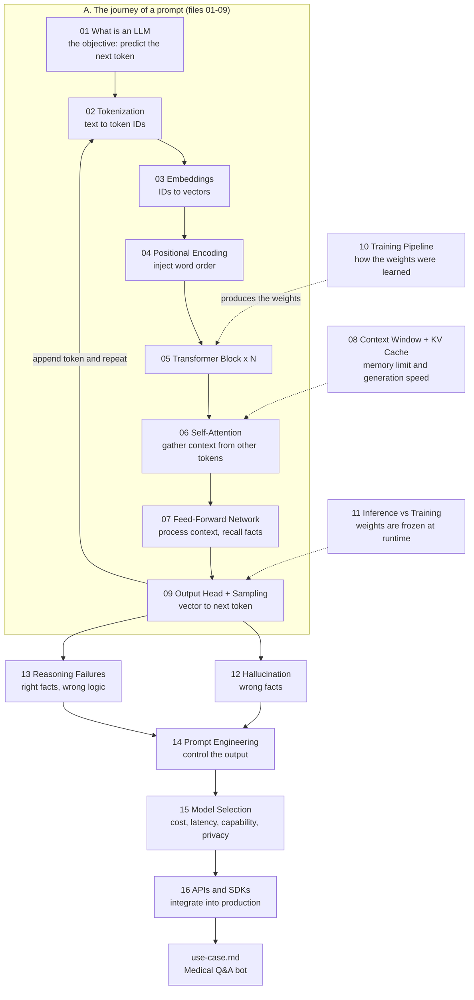

# Module 01: LLM Fundamentals

## TL;DR
This module covers the theory and engineering foundations of Large Language Models that every AI Engineer needs. Each concept is tied to a production consequence: cost, latency, reliability, and failure modes.

---

## The Big Picture (Mind Map)

The 16 files are not 16 separate topics. They describe **one system** from three angles: how a prompt flows through the model, what surrounds that flow, and what you build on top of it.

**How to read it:** solid arrows are the order data flows through the system; dotted arrows are concepts that *constrain or shape* a step. Read top to bottom: first understand the flow (A), then the forces acting on it (08, 10, 11), then how it breaks (12, 13), then how you control and ship it (14, 15, 16).

---

## Learning Path

| # | File | The question it answers | Depends on |
|---|------|------------------------|-----------|
| 01 | [what-is-an-llm](01-what-is-an-llm.md) | What is the model actually trying to do? | none |
| 02 | [tokenization](02-tokenization.md) | How does text become numbers? | 01 |
| 03 | [embeddings](03-embeddings.md) | How do numbers carry meaning? | 02 |
| 04 | [positional-encoding](04-positional-encoding.md) | How does the model know word order? | 03 |
| 05 | [transformer-architecture](05-transformer-architecture.md) | How are the pieces assembled? | 03, 04 |
| 06 | [self-attention](06-self-attention.md) | How do tokens look at each other? | 05 |
| 07 | [feed-forward-network](07-feed-forward-network.md) | Where is knowledge processed and stored? | 05, 06 |
| 08 | [context-window](08-context-window.md) | Why is memory limited, and what is the KV cache? | 06 |
| 09 | [output-head-and-sampling](09-output-head-and-sampling.md) | How does a vector become a word? | 05-07 |
| 10 | [training-pipeline](10-training-pipeline.md) | How was the model built? | 01, 05 |
| 11 | [inference-vs-training](11-inference-vs-training.md) | What changes between learning and serving? | 08, 10 |
| 12 | [hallucination](12-hallucination.md) | Why does it invent facts? | 01, 09, 10 |
| 13 | [reasoning-failures](13-reasoning-failures.md) | Why does it fail at logic with correct facts? | 01, 09 |
| 14 | [prompt-engineering](14-prompt-engineering.md) | How do I steer the output? | 08, 09, 12, 13 |
| 15 | [model-selection](15-model-selection.md) | Which model should I use? | 08, 11 |
| 16 | [llm-apis-and-sdks](16-llm-apis-and-sdks.md) | How do I call it reliably in production? | 14, 15 |

Read sequentially on a first pass. On later passes, jump straight to the file that answers your question.

**Real-world scenario:** [use-case.md](use-case.md) walks through a Medical Q&A bot where a naive setup (`temperature=1.0`, unstructured patient data in the prompt) produced plausible but dangerous hallucinated answers, and fixes it with three decisions: lower temperature (file 09), structured outputs (files 14 and 16), and grounding the answers in retrieved documents (file 12, then [02-rag](../02-rag/README.md)).

---

## Prerequisites
- Basic Python.
- Familiarity with what an API is.
- Basic linear algebra (vectors, matrices) is helpful but not required.

## Production Implications

| Concept | Production consequence |
|---------|----------------------|
| Tokenization (02) | Cost and latency are per token. Some languages, including Arabic, need more tokens per word than English, so the same content costs more. |
| Context window + KV cache (08) | Limits how much you can send, and memory use grows with sequence length. Information in the middle of a long prompt is used less reliably ("lost in the middle"). |
| Sampling (09) | `temperature` and `top_p` directly trade creativity against determinism. |
| Training vs inference (10, 11) | The model does not learn from your requests. New knowledge must come from the prompt, retrieval, or fine-tuning. |
| Hallucination (12) | The model produces plausible text, not verified truth. Safety-critical systems need grounding and validation. |

## Where This Module Leads
- Hallucination and the context limit motivate **[02-rag](../02-rag/README.md)** (give the model facts at runtime).
- The API integration patterns in file 16 are the building blocks that agents in **[03-agentic-ai](../03-agentic-ai/README.md)** are assembled from.
- SFT, RLHF and DPO from file 10 are expanded in **[04-fine-tuning](../04-fine-tuning/README.md)**.
- Sampling, token cost and latency from files 02, 08, 09 return in **[06-production](../06-production/README.md)**.

## Further Reading
- [Attention Is All You Need](https://arxiv.org/abs/1706.03762): the original Transformer paper.
- [OpenAI Platform Docs](https://platform.openai.com/docs/): practical guidance on APIs and prompt engineering.
