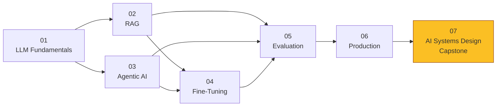

# AI Engineering Learning Journey
# AI Engineering Knowledge Base

Welcome to the AI Engineering Learning Journey documentation. This repository contains a comprehensive collection of educational resources, practical implementations, and project-based learning that adhere to best practices in AI.
> A production-first reference on building, deploying, and operating LLM-based systems.
> Not a tutorial. Not a glossary. Engineering decisions, tradeoffs, and the reasoning behind them.

## Overview
- **Educational Markdown Files**: Each markdown file provides detailed explanations and insights into various concepts related to AI engineering.
- **Practical Implementations**: Implementations are included to reinforce learning and illustrate how these concepts can be applied in real-world scenarios.
- **Projects Folder**: A dedicated folder for projects that showcases unique applications of the skills and methods learned throughout this journey.
[](.)
[](.)
[](.)
[](./LICENSE)
[](./CONTRIBUTING.md)

This documentation is meant to guide learners in their exploration and mastery of AI engineering, supporting both theoretical understanding and practical skills development.
---

## ⚠️ Found Something Wrong?

This knowledge base is community-maintained. If you spot an inaccuracy — a wrong number, an outdated API, a misleading explanation — **please don't just move on.**

Open a PR or an Issue:
- **Issue:** Describe what's wrong and in which file
- **PR:** Fix it directly following the guidelines in [CONTRIBUTING.md](./CONTRIBUTING.md)

Every correction makes this better for everyone.

---

## Who This Is For

Engineers who already know how to write code and want to understand:
- How LLMs actually work under the hood (not the marketing version)
- When to use RAG vs fine-tuning vs agents vs a simple pipeline
- How production AI systems fail and how to prevent it
- How to answer system design interviews for AI engineering roles

---

## Learning Roadmap



Each module builds on the previous ones. **Module 07 is the capstone** — it only makes sense after you've worked through the others.

---

## Modules

| # | Module | What You'll Learn | Use Case |
|---|---|---|---|
| 01 | [LLM Fundamentals](./01-llm-fundamentals/) | How LLMs work: tokenization → attention → sampling → hallucination | Medical Q&A bot |
| 02 | [RAG](./02-rag/) | Retrieval-Augmented Generation: indexing, retrieval, generation | Legal document search |
| 03 | [Agentic AI](./03-agentic-ai/) | Agents: memory, tool calling, ReAct, multi-agent systems | ERP data analyst agent |
| 04 | [Fine-Tuning](./04-fine-tuning/) | When and how to fine-tune: SFT, LoRA, DPO, RLAIF | E-commerce brand voice |
| 05 | [Evaluation](./05-evaluation/) | Measuring everything: LLM evals, RAG evals, agent evals, EDD | Customer support bot |
| 06 | [Production](./06-production/) | Guardrails, cost, observability, deployment | Banking chatbot post-mortem |
| 07 | [AI Systems Design](./07-ai-systems-design/) | Architecture decisions, patterns, case studies, interview Q&A | Startup: blank slate to architecture |

---

## How to Use This Repo

### As a learner
Follow the numbered modules in order. Each module has:
- `README.md` — overview and learning path for the module
- `use-case.md` — a real-world engineering scenario that frames everything in the module
- Numbered concept files — go deep on one concept each
- Numbered concept files — one concept per file, deep and focused

### As a reference
Jump directly to what you need. Every file is standalone with cross-references to related files.

### For interview prep
- Start with [01-llm-fundamentals/README.md](./01-llm-fundamentals/README.md) for fundamentals
- Then work through [07-ai-systems-design/05-interview-questions/](./07-ai-systems-design/05-interview-questions/) for system design
- The `resources/interview-cheat-sheet.md` has a condensed Q&A for last-minute review
- Work through [07-ai-systems-design/05-interview-questions/](./07-ai-systems-design/05-interview-questions/) for system design
- Use [resources/interview-cheat-sheet.md](./resources/interview-cheat-sheet.md) for last-minute review

---

## The Core Mental Model

```
Fixed execution path?
├── YES → Pipeline or RAG family
│         ├── No document search needed → Prompt Chaining
│         ├── One search pass enough → Standard RAG
│         ├── One search pass enough   → Standard RAG
│         └── Multi-source / self-correcting → Agentic RAG
└── NO  → Agent family
          ├── One agent sufficient → Autonomous Agent (ReAct)
          ├── Separable phases → Orchestrator + Workers
          ├── One agent sufficient     → Autonomous Agent (ReAct)
          ├── Separable phases         → Orchestrator + Workers
          └── Truly independent roles → Multi-Agent System
```

> **Golden Rule:** Start with the simplest architecture that could work. Add complexity only when the simple version demonstrably fails.

---

## Resources

- [Glossary](./resources/glossary.md) — definitions for every term used across modules
- [Interview Cheat Sheet](./resources/interview-cheat-sheet.md) — condensed Q&A for interview prep
- [Further Reading](./resources/further-reading.md) — papers, courses, tools

---

## Contributing

See [CONTRIBUTING.md](./CONTRIBUTING.md). PRs welcome — especially for:
- Additional case studies
- New use-case.md files
- Corrections to technical content
See [CONTRIBUTING.md](./CONTRIBUTING.md). PRs welcome — especially for corrections to technical content, new use-cases, and updated tooling references.

---

## License

MIT — use freely, attribute appreciated.
MIT — use freely, attribution appreciated.